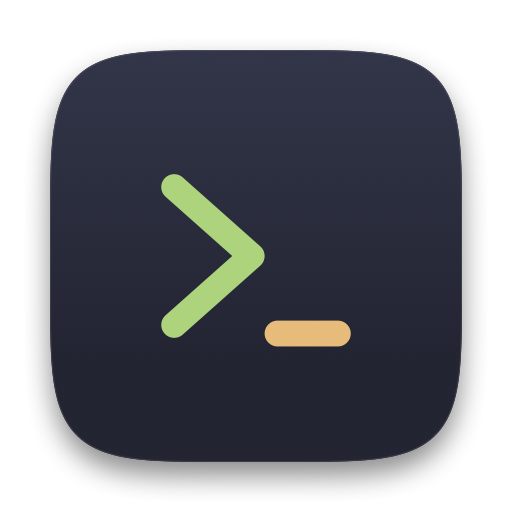
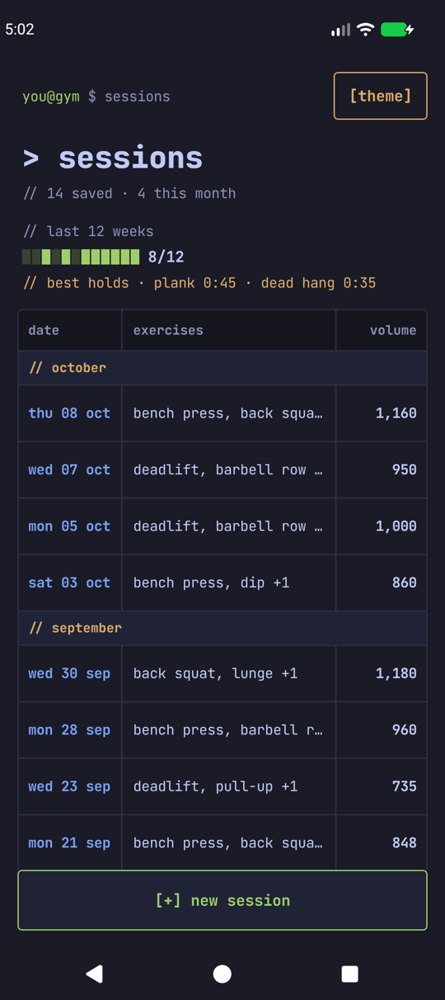
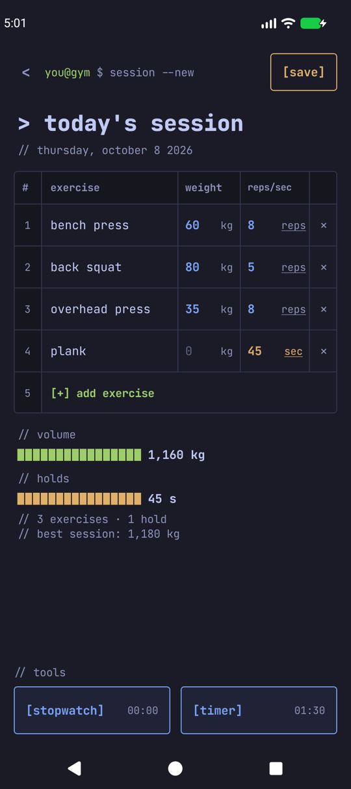
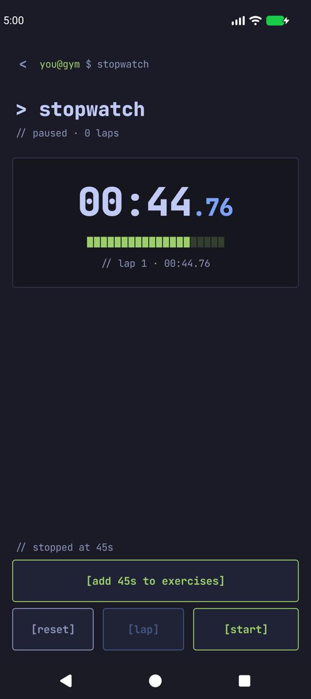
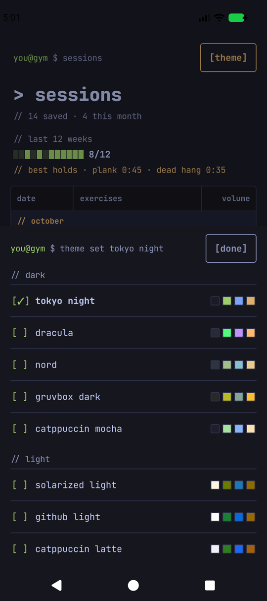

<p align="center">
  
</p>

<h1 align="center">gym init</h1>

<p align="center">
  A simple Android gym log that looks like a terminal.
</p>

<p align="center">
  <a href="../../releases/latest"><b>Download</b></a> ·
  <a href="#install"><b>Install</b></a> ·
  <a href="#use"><b>Use</b></a> ·
  <a href="#build-from-source"><b>Build from source</b></a> ·
  <a href="LICENSE"><b>MIT License</b></a>
</p>

<br>

gym init is a gym log for people who want to write a set down and get on with the next one. Every screen is
one monospace table in an editor theme, inspired by [init.Habits](https://inithabits.com). You type an exercise,
a weight and a number, and that is the whole app.

- A **spreadsheet grid** for the session: exercise, weight in kg, and reps. Switch any row to **seconds** to log
  an isometric hold.
- A **stopwatch and a timer** you can reach from the workout screen. Pause either one and an
  **`[add 45s to exercises]`** button puts that time into the workout as a hold.
- **Every saved session** on one page, grouped by month, with volume, a bar for the last 12 weeks and your best
  holds. Tap one to edit it.
- **Eight editor themes**, applied to every screen.
- No account, no network access, no ads. Your sessions are one small file on your phone.

Requires Android 8.0 or later.

<p align="center">
  
  
  
  
</p>

<p align="center">
  <sub><b>Sessions</b> &nbsp;·&nbsp; <b>Workout</b> &nbsp;·&nbsp; <b>Pause, then add to exercises</b> &nbsp;·&nbsp; <b>Themes</b></sub>
</p>

## Install

1. On your phone, open the [Releases](../../releases) page and download the latest `gym-init-<version>.apk`.
2. Open the file. Android will ask you to allow installing apps from your browser or files app (this is how you
   install anything that doesn't come from the Play Store). Allow it for that one app.
3. Install. If Google Play Protect asks to scan the app, choose **Install anyway**: the app is not on the Play
   Store, and the release is signed with a debug key.
4. Open **gym init**. It starts on a new, empty workout.

The release is a debug build. Prefer to read the code first? It is all in this repository, and you can build it
yourself (below).

### Updating

Download the newer APK and open it. It installs over the old one and keeps your sessions, theme and settings.
That only works between APKs signed with the same key, which is the case for the ones on the Releases page. An
APK you build yourself, or one from the GitHub Actions run, is signed with your own debug key: Android will refuse
to install it over a release, and you would have to uninstall first, which erases your sessions.

## Use

Four screens, all in the same terminal style. Every button is a `[bracket]`.

| Screen | What it does |
|--------|--------------|
| **Workout** (opens first) | The grid for today's session: `exercise / weight / reps` (or seconds). `[+] add exercise` adds a row, `×` removes one, `[save]` stores the session and takes you to Home. Volume (kg × reps) and hold time are totalled underneath. `[stopwatch]` and `[timer]` open those screens and show their live time. |
| **Home** | Every saved session, newest first, grouped by month, with that session's volume. Above the list: a bar for the last 12 weeks (a block is filled when that week had a session) and your best holds. Tap a session to edit it. `[theme]` opens the theme picker. `[+] new session` starts a fresh workout. |
| **Stopwatch** | Start, pause and reset, with laps (the fastest lap is green, the slowest amber). Pause it and `[add Ns to exercises]` appears. |
| **Timer** | Count down from a preset (0:30 to 5:00) or adjust by 15 seconds. Beeps and vibrates at zero. Pause or finish it and `[add Ns to exercises]` appears here too. |

The stopwatch and timer keep running while you go back to the workout, and its two buttons show their live time.

### Unsaved sessions

A session you haven't saved is kept as a draft, even if you press back to Home or Android closes the app. Home
lists it under **`// in progress`**: tap it to carry on. `[+] new session` asks before throwing it away.

### Editing a session, and carrying on after saving by accident

Tap a saved session on Home to edit it. There, `[del]` deletes it, and **`[resume]`** carries on with it: you
get the normal workout screen back, with the stopwatch and timer, and keep adding to the same session. Changes
are saved as you go, and the session sits under `// in progress` on Home until you save it again.

### Holds

Tap `reps` next to a number to switch that row to `sec`. A hold is one row, so three sets of a plank are three
rows. It isn't counted in the kg volume: it gets its own total, `// holds`, and shows on Home as `plank 45s`.
The easy way to log one:

1. Open the **stopwatch** (or the **timer**), start it, hold, then pause it.
2. Tap **`[add 45s to exercises]`**. The stopwatch adds the total time on it, whatever the laps. The timer adds
   how long it has run, which is its goal minus what is left.
3. You land back on the workout with a new row filled in and the cursor in its name. Type the name.

Home lists each exercise once however many sets it has, and a hold shows its longest time. Exercise names are saved
in lowercase, so `Plank` and `plank` are the same exercise.

### Themes

Choose **`[theme]`** on Home. Five dark and three light, applied to every screen: tokyo night (the default),
dracula, nord, gruvbox dark, catppuccin mocha, solarized light, github light and catppuccin latte.

## What it can't do

- The timer only runs while the app is alive. There is no foreground service or notification yet, so if Android
  closes the app in the background, or the phone sleeps for a long while, it may not ring.
- It keeps one weight and one number per row. There is no per-set history, so log each set as its own row.
- Your sessions are only on your phone: there is no sync, backup or export.
- Volume is plain weight × reps added up. A hold, or an exercise with no weight, adds nothing to it.
- The release is not signed for the Play Store (see Install).

## Build from source

You need **JDK 17** (Gradle and Kotlin here don't run on 21 or later) and the Android SDK with platform 35.

```bash
./gradlew assembleDebug
# the APK is at app/build/outputs/apk/debug/app-debug.apk
```

On macOS, `brew install openjdk@17` and point `JAVA_HOME` at it. Gradle looks for the SDK through `ANDROID_HOME` or
a `local.properties` file with `sdk.dir=/path/to/sdk`. You can also open the folder in Android Studio and press
Run. Every push builds a debug APK in GitHub Actions (see the `build` workflow's artifacts).

The app is Kotlin and Jetpack Compose, with Material 3 used only for the dialog and the bottom sheet. There is no
database: sessions are one JSON file in app storage, and preferences hold the theme, the timer's goal and the
unsaved drafts. It is a single `Activity` and one `ViewModel`. The font is JetBrains Mono, bundled.

```
app/src/main/java/com/gyminit/
  MainActivity.kt      app shell, edge-to-edge, back handling
  AppViewModel.kt      all state: navigation, drafts, sessions, stopwatch, timer, holds
  Data.kt              models, JSON storage, formatting
  Theme.kt             the eight themes and the font
  Ui.kt                bracket buttons, table cells, text fields, bars
  WorkoutScreen.kt  HomeScreen.kt  StopwatchScreen.kt  TimerScreen.kt
```

`tools/make_logo.sh` redraws `assets/logo.png`. `CLAUDE.md` has the design rules and notes for working on the code.

## Uninstall

Remove it like any app. That deletes your sessions, since they are stored with the app.

## License

MIT for the app code. JetBrains Mono is bundled under the SIL Open Font License (see `FONT-LICENSE-OFL.txt`).
